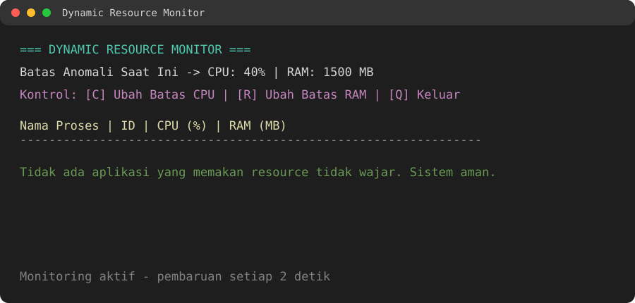
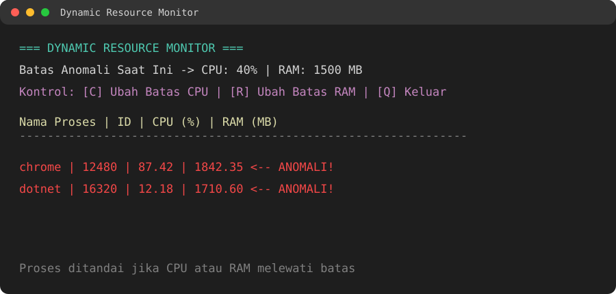

# Dynamic Resource Monitor

Aplikasi konsol berbasis .NET 8 untuk memantau penggunaan CPU dan RAM setiap proses yang sedang berjalan. Aplikasi menampilkan proses yang melewati batas penggunaan resource yang ditentukan dan menyediakan pengaturan batas secara langsung saat aplikasi berjalan.

## Fitur

- Memantau seluruh proses yang sedang berjalan.
- Menghitung penggunaan CPU berdasarkan perubahan waktu CPU antar-siklus pemantauan.
- Menampilkan penggunaan RAM dalam MB.
- Menandai proses sebagai **ANOMALI** apabila:
  - penggunaan CPU melebihi batas CPU; atau
  - penggunaan RAM melebihi batas RAM.
- Mengubah batas CPU dan RAM tanpa menghentikan aplikasi.
- Membersihkan data proses yang sudah berhenti dari cache pemantauan.
- Memperbarui tampilan dashboard setiap 2 detik.

## Persyaratan

- .NET 8 SDK atau runtime.
- Sistem operasi yang mendukung `System.Diagnostics.Process`.
- Akses untuk membaca informasi proses. Beberapa proses sistem mungkin tidak dapat dibaca karena pembatasan akses sistem operasi.

## Menjalankan Aplikasi

Dari direktori root repositori, jalankan:

```powershell
dotnet run --project .\DynamicResourceMonitor\DynamicResourceMonitor.csproj
```

Atau, masuk ke direktori proyek terlebih dahulu:

```powershell
cd .\DynamicResourceMonitor
dotnet run
```

Untuk membuat build tanpa menjalankan aplikasi:

```powershell
dotnet build
```

## Penggunaan

Saat aplikasi berjalan, dashboard menampilkan nama proses, ID proses, penggunaan CPU, dan penggunaan RAM.

| Tombol | Fungsi |
|---|---|
| `C` | Mengubah batas penggunaan CPU dalam persen |
| `R` | Mengubah batas penggunaan RAM dalam MB |
| `Q` | Menghentikan aplikasi |

Nilai awal batas anomali:

- CPU: `40%`
- RAM: `1500 MB`

Setelah menekan `C` atau `R`, masukkan nilai baru sesuai satuan yang diminta. Contoh nilai CPU adalah `25.5`, sedangkan contoh nilai RAM adalah `2000`.

## Screenshot Aplikasi

### Kondisi Normal

Saat tidak ada proses yang melewati batas CPU atau RAM, aplikasi menampilkan pesan bahwa sistem aman.



### Kondisi Ditemukan Anomali

Proses yang melewati salah satu batas ditampilkan dengan warna merah dan penanda `ANOMALI!`.



## Contoh Tampilan

```text
=== DYNAMIC RESOURCE MONITOR ===
Batas Anomali Saat Ini -> CPU: 40% | RAM: 1500 MB
Kontrol: [C] Ubah Batas CPU | [R] Ubah Batas RAM | [Q] Keluar

Nama Proses                 | ID       | CPU (%)  | RAM (MB)
----------------------------------------------------------------
Tidak ada aplikasi yang memakan resource tidak wajar. Sistem aman.
```

Jika proses melewati salah satu batas, proses tersebut ditampilkan dengan penanda `ANOMALI!`.

## Struktur Proyek

```text
DynamicResourceMonitor/
├── DynamicResourceMonitor.slnx
├── DynamicResourceMonitor/
│   ├── DynamicResourceMonitor.csproj
│   └── Program.cs
├── docs/
│   └── images/
│       ├── monitoring-normal.svg
│       └── monitoring-anomaly.svg
└── README.md
```

## Catatan Teknis

- Target framework proyek adalah `net8.0`.
- Pemantauan CPU membutuhkan setidaknya dua kali pengambilan data agar dapat menghitung perubahan waktu CPU.
- Proses yang baru muncul akan mulai memiliki nilai CPU setelah siklus berikutnya.
- Error saat membaca proses tertentu, seperti `Access Denied`, diabaikan agar pemantauan proses lain tetap berjalan.
- Nilai batas hanya berlaku selama aplikasi sedang berjalan dan belum disimpan ke konfigurasi permanen.
- Persentase CPU dihitung relatif terhadap jumlah prosesor logis yang tersedia pada komputer.

## Lisensi

Belum ada lisensi open-source yang ditentukan untuk proyek ini.
